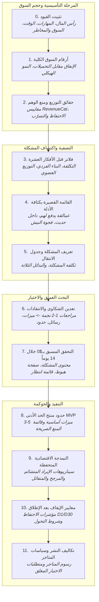

# بروتوكول اختيار وبناء المشروع — من الفكرة إلى القرار بأرقام

> **إطار عمل مدفوع بالأدلة والأرقام للتحقق من جدوى أفكار التطبيقات والمشاريع الرقمية قبل كتابة سطر برمجي واحد.**

[](#)
[](SKILL.md)
[](LICENSE)

[**English Documentation (README.md)**](README.md) | [**مهارة كلود (SKILL.md)**](SKILL.md) | [**البروتوكول المرجعي الأصلي**](references/KHALIL_COLDSTART_PROTOCOL.md)

---

## المشكلة التي يعالجها البروتوكول

مع ظهور أدوات البرمجة بالذكاء الاصطناعي وأطر العمل الحديثة، انخفضت تكلفة كتابة الكود البرمجي وسرعته بصورة غير مسبوقة. لكن **مخاطر السوق والتوزيع لم تتغير**: الأغلبية الساحقة من التطبيقات والمشاريع الفردية تفشل في تحقيق أي إيراد يذكر، أو تعاني من نسب تسرّب مرتفعة للمستخدمين، أو تفشل تماماً في اكتساب جمهور عضوي.

يقع أغلب المطورين والمؤسسين في فخ «البدء بالحل لا بالمشكلة»:
- قضاء أسابيع أو شهور في برمجة وتصميم تطبيق متكامل قبل التأكد من وجود عملاء يعانون من المشكلة ويدفعون لحلها.
- الاعتماد على الآراء العاطفية، أو مجاملات الأصدقاء، أو الحماس غير المنضبط.
- بناء خوادم وبنى تحتية معقدة ومكلفة لأفكار كان يمكن اختبار الطلب الحقيقي عليها خلال 14 يوماً فقط ودون أي تكلفة مالية.

يقدم هذا البروتوكول مساراً بحثياً وعملياً من 12 مرحلة منضبطة بالأرقام، يحمي المطور من الخداع الإحصائي وأوهام الثراء السريع، ويستخرج نقاط القوة الحقيقية من شكاوى مستخدمي المنافسين، ويضع بوابات قرار رقمية واضحة تفرض إما الاستمرار، أو تعديل المسار (Pivot)، أو إيقاف الفكرة قبل إهدار الوقت والمال.

---

## الفلسفة الحاكمة للبروتوكول

يقوم البروتوكول على خمس قواعد ذهبية غير قابلة للتفاوض:

1. **الأدلة قبل الآراء (Evidence Before Opinions):** القرارات الاستراتيجية تبنى على وقائع رقمية قابلة للرصد والتحقق (تقارير متاجر، بيانات مالية موثقة، شكاوى مستخدمين منشورة)، لا على التفاؤل المجرد.
2. **المشكلة قبل التطبيق (Problem Before Product):** لا يناقش كود ولا واجهات قبل تعريف المشكلة التي يدفع العميل لحلها، وتكلفة استمرارها عليه (وقتاً، مالاً، جهداً، أو سمعة)، وتحليل سبب تركه للبدائل الحالية.
3. **التحقق قبل البرمجة (Validation Before Coding):** تنفيذ تجربة تحقق مسبق لمدة 14 يوماً باختبار المحتوى ورسائل القيمة وقوائم الانتظار قبل كتابة أول سطر كود للمنتج.
4. **بوابات قرار رقمية صارمة (Measurable Decision Gates):** تنتهي كل مرحلة بقرار صريح: **استمرار (Pass)**، **تعديل مسار (Pivot)**، أو **إيقاف الفكرة (Kill)**.
5. **ممنوع اختلاق الأرقام (Zero Invented Numbers):** كل رقم يجب أن يُقرن بمصدره وتاريخه. إذا كان الرقم غير متاح، يُكتب «غير متوفر» صراحة ويُبنى بديل قياس تحفظي. لا وعود بنجاح مضمون بنسبة مئة بالمئة.

---

## دورة التحقق وسير العمل

ينتقل البروتوكول عبر مراحله الـ12 بتسلسل هندسي مترابط:



---

## تفصيل مراحل البروتوكول الـ12

| المرحلة | اسم المرحلة | الهدف والمخرج الأساسي |
|---|---|---|
| **0** | **تثبيت القيود** | توثيق رأس المال المتاح (حتى لو كان صفراً)، المهارات البرمجية، الساعات اليومية، النطاق الجغرافي المستهدف، والمخاطر المرفوضة (مثل القطاعات التنظيمية المعقدة). أي فكرة تخالف هذه القيود تُقتل فوراً. |
| **1** | **أرقام السوق الكلية** | دراسة حجم الإنفاق الاستهلاكي داخل المتاجر، ومقارنة سرعة نمو الإيراد بنمو التحميلات للتأكد من أن الفئة تدفع فعلياً مقابل القيمة وليست مجرد فخ تحميلات مجانية. |
| **2** | **حقائق التوزيع ومنع الوهم** | تطبيق المقاييس الواقعية للصناعة لتفادي أوهام الثراء السريع؛ مثل حقيقة أن ~17–20% فقط من تطبيقات الاشتراكات الجديدة تصل إلى إيراد \$1,000 شهرياً خلال سنتين، وحقيقة تركّز 92% من الإيرادات لدى أعلى 1% من الناشرين. |
| **3** | **فلاتر قتل الأفكار** | إخضاع الفكرة لـ10 فلاتر حاسمة: صفر تكلفة بنية تحتية ثابتة، قابلة للبناء خلال 4–8 أسابيع، نيش مثبت إحصائياً، إمكانية التوزيع العضوي المجاني، إيراد دفع حاسم ومبكر، بلا تراخيص معقدة، أولوية iOS للربحية، تكرار المشكلة أسبوعياً، أصالة التنفيذ البرمجي، ووجود إثبات دفع حديث في السوق خلال آخر 12 شهراً. |
| **4** | **القائمة القصيرة بكثافة الأدلة** | اشتراط توافر 3 أدلة مستقلة لكل مرشح: (1) وجود عمالقة يربحون حالياً، (2) وجود منافس دخل في آخر سنة وأثبت الإيراد، و(3) فجوة نيش غير مشبعة إحصائياً. |
| **5** | **تعريف المشكلة وجدول الانتقال** | صياغة المشكلة بلسان العميل وتحديد النتيجة التي يشتريها، وبناء جدول مقارنة مع 3 بدائل: الحل المجاني الافتراضي، التطبيق الرائد المدفوع، والحل اليدوي/الشعبي. |
| **6** | **تعدين الشكاوى والانتقادات** | فحص تقييمات 1–2 نجمة للمنافسين على App Store وGoogle Play ومنتديات Reddit المتخصصة لاستخراج المشاكل التقنية والتشغيلية المكررة. |
| **7** | **التحقق المسبق لـ14 يوماً بـ$0** | خطة عملية لاختبار رسالة القيمة وشدة المشكلة عبر نشر 10 فيديوهات تركز على المشكلة وتوجيه المشاهدين لصفحة هبوط مع قائمة انتظار لقياس الاهتمام الفعلي قبل كتابة الكود. |
| **8** | **حدود منتج الحد الأدنى (MVP)** | حصر النطاق في 3–5 قدرات حاسمة تعالج سبب الانتقال الأساسي، مع وضع قائمة صريحة بالميزات الممنوعة أو المؤجلة لمنع تضخم المشروع. |
| **9** | **النمذجة الاقتصادية المتحفظة** | بناء سيناريوهات مالية ثلاثية (متشائمة، مرجحة، متفائلة) تحسب مسار التحويل من المشاهدات العضوية إلى التحميلات، ثم التجارب المجانية، ثم الاشتراكات المدفوعة بعد خصم نسب التسرّب الشهري (Churn). |
| **10** | **معايير الإيقاف والتحول بعد الإطلاق** | تحديد مؤشرات رقمية واضحة للأداء (مثل بقاء الاحتفاظ باليوم الأول D1 أقل من 25% بعد تحسينين موثقين) تفرض التحول لزاوية أخرى داخل نفس النيش. |
| **11** | **تكاليف النشر وسياسات المتاجر** | التحقق من الرسوم الحالية وسياسات المتاجر المستحدثة (مثل متطلبات Google Play للحسابات الشخصية بضرورة إجراء اختبار مغلق مع 12 مختبراً لمدة 14 يوماً متواصلة) وحساب تكاليف التشغيل بدقة. |

---

## منهجية تعدين الشكاوى (Complaint Mining)

تمثل المرحلة السادسة جوهر البروتوكول ومحرك ابتكار القيمة؛ فبدلاً من اختراع ميزات افتراضية في فراغ، يقوم المطور بمسح منظم لتقييمات 1 و2 نجمة لأقوى 3 إلى 5 منافسين.

تُصنف كل شكوى مرتفعة التكرار إلى قرار عملي مباشر:
1. **ميزة تنافسية صريحة (Feature):** حل هندسي لمشكلة يعجز عنها المنافس (مثل: إضافة نظام التحقق الحي لمنع الغش في منبه المهام).
2. **رسالة تسويقية وزاوية إعلان (Angle/Hook):** تسليط الضوء على نقطة ضعف المنافس في الواجهة والإعلانات (مثل: «منبه بدون أي إعلانات مزعجة وقت الاستيقاظ»).
3. **حد منتج صارم (Product Boundary):** قرار واعٍ برفض سلوك يمارسه المنافس ويضر المستخدمين (مثل: رفض إدراج أنظمة تتبع تستهلك البطارية).

---

## تجربة التحقق المسبق (14 يوماً بـ$0)

قبل فتح بيئة التطوير، ينفذ المطور سباق تحقق عملي منخفض التكلفة:
- **اليومان 1–2:** تعدين تقييمات المنافسين واستخلاص فرضيات المشكلة.
- **اليومان 3–4:** فحص مجاني للكلمات المفتاحية وحجم البحث (ASO Autocomplete).
- **الأيام 5–12:** إنتاج 10 مقاطع فيديو قصيرة (TikTok/Reels) تتمحور بالكامل حول **المشكلة الحقيقية** ومعاناة المستخدم اليومية (وليس عن تطبيق لم يُبْنَ بعد)، مع توجيه الجمهور لصفحة هبوط مجانية تحوي قائمة انتظار (Waitlist).
- **اليومان 13–14 — بوابة القرار:**
  - **شرط النجاح (قاعدة إرشادية):** تسجيل 300+ في قائمة الانتظار أو تجاوز فيديو حاجز 100 ألف مشاهدة بتعليقات تؤكد الحاجة ← الانتقال الفوري لمرحلة البناء.
  - **شرط الإخفاق / التعديل:** أقل من 100 مسجل وضعف المشاهدات ← تعديل زاوية الطرح (Pivot) واختبار زاوية بديلة خلال أسبوعين دون أي خسارة مالية.

---

## النمذجة الاقتصادية وقواعد ما بعد الإطلاق

تُبنى التوقعات المالية بمسار هبوطي تحفظي:

$$\text{مشاهدات المحتوى العضوي} \xrightarrow{\times 1\%} \text{تثبيت التطبيق} \xrightarrow{\times 5\%} \text{بدء التجربة المجانية} \xrightarrow{\times 45\%} \text{التحويل لاشتراك مدفوع} \xrightarrow{-8\% \text{ تسرّب شهري}} \text{الإيراد المتكرر المستقر}$$

- هذه الحسابات هي نمذجة رياضية محايدة وليست وعوداً بالربح.
- معايير الإيقاف تحمي المطور من التعلق بمشاريع ميتة: إذا كان الاحتفاظ باليوم الأول D1 أقل من 25% أو التحويل للدفع أقل من 2% بعد تحسينين تقنيين موثقين، يتم إيقاف الإصدار والتحول لزاوية أخرى فوراً.

---

## مهارة كلود (Claude Skill): التثبيت والاستخدام

يتضمن المستودع ملف مهارة رسمية مستقلة متوافقة مع مواصفات Claude Skills في [`SKILL.md`](SKILL.md) لتنفيذ هذا البروتوكول تفاعلياً.

### طريقة التثبيت

#### الخيار الأول: مشاريع كلود والتعليمات المخصصة (Claude Projects)
1. في واجهة Claude.ai، افتح مشروعك (Project) أو التعليمات المخصصة (Custom Instructions).
2. أضف محتوى ملف [`SKILL.md`](SKILL.md) وملف [`references/KHALIL_COLDSTART_PROTOCOL.md`](references/KHALIL_COLDSTART_PROTOCOL.md) إلى قاعدة معرفة المشروع (Project Knowledge).

#### الخيار الثاني: حزمة مهارة مضغوطة (.zip)
1. قم بضغط ملف `SKILL.md` مع مجلد `references/` في ملف أرشيف `.zip`.
2. ارفع الأرشيف عبر واجهة إدارة مهارات كلود المتاحة في حسابك.

### نموذج طلب عملي مقترح (Prompt)

```text
طبّق بروتوكول اختيار وبناء المشروع على: فكرة تطبيق لتعلم التحدث بالإنجليزية للموظفين العرب
القيود:
- رأس المال المتاح: $100 كحد أقصى لتكاليف حسابات المطورين
- المهارات التقنية: تطوير تطبيقات الجوال باستخدام Flutter
- الوقت المتاح: ساعتان يومياً (14 ساعة أسبوعياً)
- السوق المستهدف: السعودية والإمارات (دول الخليج)
- المخاطر المرفوضة: لا اشتراكات في خوادم سحابية ذات تكاليف ثابتة، لا APIs باهظة التكلفة
```

سيقوم كلود بتفعيل المهارة تلقائياً، والرد باللغة العربية المهنية، وتنفيذ المراحل الـ12 بالترتيب، وتوثيق مصادر كل رقم أو الإقرار بعدم توفره، وتطبيق بوابة القرار الصريحة في نهاية كل مرحلة.

---

## هيكل المستودع ومحتوياته

```text
app-idea-validation-protocol/
├── README.md                           # التوثيق الإنجليزي العام للمستودع
├── README.ar.md                        # الدليل العربي الشامل للمستودع والمهارة
├── SKILL.md                            # تعريف مهارة كلود وسير العمل التنفيذي
├── LICENSE                             # ترخيص الاستخدام البرمجي المفتوح
├── CONTRIBUTING.md                     # إرشادات المساهمة والتطوير
├── SECURITY.md                         # سياسة الإبلاغ عن الثغرات الأمنية
├── CHANGELOG.md                        # سجل الإصدارات والتحديثات
├── .gitignore                          # ملف استبعاد الملفات غير المرغوبة من Git
├── .gitattributes                     # ضبط نهايات الأسطر والخصائص لـ Git
├── references/
│   └── KHALIL_COLDSTART_PROTOCOL.md    # النص الكامل للبروتوكول العربي الأصلي غير المعدل
├── docs/
│   ├── methodology.md                  # التفصيل الفلسفي للمنهجية وتكامل المراحل
│   ├── decision-gates.md               # تصنيف بوابات القرار (الاستمرار، التعديل، الإيقاف)
│   ├── evidence-standards.md           # معايير تصنيف الأدلة والتعامل مع البيانات الناقصة
│   └── source-verification.md          # دليل التحقق من سياسات المتاجر والمصادر الخارجية
└── .github/
    ├── ISSUE_TEMPLATE/
    │   ├── bug_report.md               # نموذج الإبلاغ عن أخطاء في البروتوكول
    │   └── improvement_request.md      # نموذج اقتراح تحسينات منهجية
    ├── workflows/
    │   └── validate.yml                # مسار عمل GitHub Actions للتحقق من سلامة الملفات
    └── PULL_REQUEST_TEMPLATE.md        # نموذج طلبات السحب (Pull Requests)
```

---

## الوثائق المرجعية الداعمة

- [**منهجية البحث والتحقق (`docs/methodology.md`)**](docs/methodology.md): تفصيل فلسفة البدء بالمشكلة وتكامل المراحل الـ12.
- [**بوابات القرار والمعايير (`docs/decision-gates.md`)**](docs/decision-gates.md): تصنيف معايير الاستمرار والتعديل والإيقاف والتمييز بين القيود الصارمة والقواعد الإرشادية.
- [**معايير الأدلة وجودة البيانات (`docs/evidence-standards.md`)**](docs/evidence-standards.md): قواعد تصنيف الحقائق المشاهدة والاستنتاجات والفرضيات والتعامل مع البيانات المتضاربة.
- [**دليل التحقق من المصادر والمتاجر (`docs/source-verification.md`)**](docs/source-verification.md): كيفية مراجعة سياسات المتاجر وبيانات المنافسين وتدقيق الأرقام المرجعية.

---

## سياسة حداثة البيانات والأرقام المرجعية

تتغير أرقام الأسواق ورسوم المنصات وسياسات النشر بمرور الوقت:
- يحتوي البروتوكول على لقطة مرجعية رقمية موثقة بتاريخ **نوفمبر 2026** داخل [`references/KHALIL_COLDSTART_PROTOCOL.md`](references/KHALIL_COLDSTART_PROTOCOL.md).
- عند تشغيل البروتوكول، يلتزم المستخدم ومساعد الذكاء الاصطناعي بإعادة التحقق من الأرقام الحالية وقت الاستخدام (مثل سياسات Google Play ومعدلات رسوم Apple وتقارير الإيرادات الحديثة).
- لا يجوز التعامل مع الأرقام التاريخية على أنها ثوابت مطلقة لا تتغير.

---

## المساهمة والتطوير

نرحب بالمساهمات المنهجية التي ترفع دقة الأدلة، وتحدث المؤشرات الإحصائية للمتاجر، وتطور نماذج التحقق. يرجى الاطلاع على دليل المساهمة [CONTRIBUTING.md](CONTRIBUTING.md) قبل تقديم طلبات السحب.

---

## الترخيص والملكية الفكرية

هذا المستودع من إعداد وتطوير **خليل محمد خليل** ([@Khalil-M-Khalil](https://github.com/Khalil-M-Khalil)).

البروتوكول منشور ومتاح للاستخدام بموجب ترخيص [MIT License](LICENSE).

---

## إخلاء المسؤولية القانونية والتجارية

يقدم هذا الإطار أدوات تحليلية وإرشادية لتقليل المخاطر ودعم اتخاذ القرار، ولا يضمن تحقيق أرباح أو نجاح تجاري أو الوصول لملاءمة المنتج مع السوق (Product-Market Fit). تظل المسؤولية القانونية والمالية الكاملة لتقييم جدوى المشاريع على عاتق المطور أو صاحب العمل قبل استثمار أي أموال.
