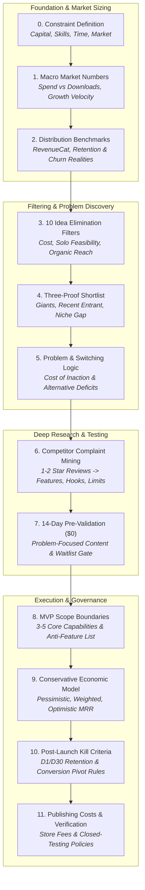

# App Idea Validation Protocol

> **An evidence-driven framework for validating app ideas before writing code.**

[](#arabic-documentation)
[](SKILL.md)
[](LICENSE)

[**النسخة العربية من دليل الاستخدام (README.ar.md)**](README.ar.md) | [**Claude Skill (SKILL.md)**](SKILL.md) | [**Original Protocol Reference**](references/KHALIL_COLDSTART_PROTOCOL.md)

---

## The Problem

AI coding tools and modern frameworks have reduced the cost of writing code to near zero. However, **market risk remains unchanged**: the overwhelming majority of indie apps and side projects generate zero revenue, suffer rapid churn, or fail to gain organic traction.

Founders routinely fall into the "solution-first" trap:
- Spending months engineering an intricate product before verifying whether anyone experiences the problem intensely enough to pay.
- Relying on vague opinions, positive feedback from friends, or speculative vanity metrics.
- Over-engineering backends and infrastructure for products that could be tested in 14 days with zero capital.

The **App Idea Validation Protocol** replaces entrepreneurial guesswork with a structured, 12-stage validation pipeline. It forces builders to examine cold hard market distribution figures, mine 1–2 star competitor complaints for real switching triggers, execute a zero-dollar pre-validation test, and enforce measurable decision gates before committing a single line of production code.

---

## Core Philosophy

1. **Evidence Before Opinions:** Strategic choices must rely on observable facts (store metrics, financial disclosures, verified user grievances), not optimism.
2. **Problem Before Product:** Never design a feature or UI before defining the user's current cost (time, money, reputation, emotional frustration) and why they would abandon current workarounds.
3. **Validation Before Coding:** Execute a low-cost, 14-day pre-validation experiment to test positioning and demand before writing code.
4. **Measurable Decision Gates:** Every phase ends with an unambiguous choice: **Continue (Pass)**, **Pivot**, or **Kill**.
5. **Zero Invented Numbers:** If a metric is inaccessible, declare it unavailable and adopt a conservative proxy. No guaranteed-success promises.

---

## Validation Lifecycle

The framework moves sequentially through 12 rigorous stages:



---

## The 12 Protocol Stages

| Stage | Stage Name | Purpose & Primary Output |
|---|---|---|
| **0** | **Constraint Definition** | Records budget, developer skills, daily available hours, target geography, and off-limits sectors. Any idea violating constraints is eliminated immediately. |
| **1** | **Macro Market Numbers** | Compares consumer spending vs. download growth across platforms (iOS vs Android) and regions. Evaluates whether the tide is rising for utility subscriptions. |
| **2** | **Distribution Realities** | Inoculates against unrealistic wealth fantasies using verified empirical benchmarks (e.g., only ~17–20% of new subscription apps reach \$1,000/mo within two years). |
| **3** | **10 Elimination Filters** | Tests candidates against 10 ruthless filters: \$0 fixed server cost, solo buildable in 4–8 weeks, proven niche data, organic \$0 distribution, decisive upfront paywall, zero complex licensing, iOS prioritization, frequent weekly pain point, clean-room originality, and recent proof of payment. |
| **4** | **Evidence Shortlist** | Mandates three independent proofs in the same direction: (1) Monetizing market leaders, (2) Recent entrants (<12 months old) succeeding today, and (3) Statistically uncrowded niche metrics. |
| **5** | **Problem & Switching Table** | Formulates the core customer problem in real customer language. Maps out the three default alternatives (the free default, the paid incumbent, the popular DIY hack) and identifies specific switching rationales. |
| **6** | **Complaint Mining** | Systematic inspection of 1–2 star reviews of top competitors on App Store, Google Play, Reddit, and review aggregators to uncover authentic user frustrations. |
| **7** | **14-Day Pre-Validation** | A zero-dollar validation sprint testing messaging and audience resonance using problem-centric short-form videos and a simple landing page waitlist before writing code. |
| **8** | **MVP Scope Boundaries** | Locks down 3–5 core capabilities focused on the primary switching driver, paired with an explicit list of forbidden/deferred features to prevent scope creep. |
| **9** | **Conservative Unit Economics** | Models pessimistic, weighted, and optimistic financial scenarios based on organic reach, conservative conversion benchmarks (2–5%), and expected churn (6–10%). |
| **10** | **Post-Launch Kill Rules** | Pre-defines objective telemetry triggers (e.g., Day 1 retention < 25% or Day 30 retention < 5% after two disciplined iterations) that mandate a pivot. |
| **11** | **Publishing Costs & Policies** | Audits live store policies (e.g., Apple Developer \$99/yr, Google Play \$25 fee plus 12-tester / 14-day closed testing rules for personal accounts) before allocating funds. |

---

## Competitor Complaint Mining

Stage 6 forms the analytical heart of the protocol. Rather than brainstorming theoretical features, the builder audits negative user reviews across 3–5 leading competitors.

Every high-frequency complaint is converted into one of three decisions:
1. **A Core Competitive Feature:** Direct engineering resolution of a systematic incumbent failure (e.g., creating an anti-cheat verification mechanism for an alarm app).
2. **A Marketing Hook / Angle:** Highlighting the competitor's flaw directly in landing page copy and social hooks (e.g., "An alarm with zero loud ads during morning wake-up").
3. **A Strict Product Boundary:** A deliberate design constraint preventing the team from repeating the competitor's mistake (e.g., refusing to insert battery-draining background trackers).

---

## The 14-Day Pre-Validation Experiment (\$0)

Before opening an IDE, the builder executes a 14-day zero-capital validation test:
- **Days 1–2:** Mine competitor reviews and formulate customer pain hypotheses.
- **Days 3–4:** Conduct free App Store Optimization (ASO) search intent analysis (evaluating store autocomplete and keyword competition).
- **Days 5–12:** Produce and publish 10 short-form video variations (TikTok/Reels) focusing entirely on the **problem** (not the app), driving traffic to a free landing page with a waitlist.
- **Days 13–14 — The Decision Gate:**
  - **Pass Threshold (Heuristic):** ≥300 qualified waitlist signups or ≥1 video exceeding 100k organic views with clear intent comments → Proceed to MVP build.
  - **Fail / Pivot Threshold:** <100 waitlist signups and <10k reach → Pivot to an alternate angle or problem without financial loss.

---

## Economic Modeling & Post-Launch Decision Rules

Unit economics are projected using a conservative waterfall model:

$$\text{Organic Impressions} \xrightarrow{\times 1\%} \text{Store Installs} \xrightarrow{\times 5\%} \text{Paywall Trials} \xrightarrow{\times 45\%} \text{Paid Subscribers} \xrightarrow{-8\% \text{ Churn}} \text{Stable MRR}$$

- Projections are explicit mathematical models, never revenue guarantees.
- Post-launch rules prevent lingering in zombie projects: if Day 1 retention remains under 25% or paywall conversion remains under 2% after two documented optimization cycles, the project pivots to a different angle within the same niche.

---

## Claude Skill: Installation & Usage

This repository includes an official, self-contained **Claude Skill** located at [`SKILL.md`](SKILL.md) that empowers Claude to execute this protocol interactively.

### Installation

#### Option A: Project Knowledge / Custom Instructions (Web & Desktop)
1. In Claude.ai, open your Project settings or Custom Instructions.
2. Add the contents of [`SKILL.md`](SKILL.md) and [`references/KHALIL_COLDSTART_PROTOCOL.md`](references/KHALIL_COLDSTART_PROTOCOL.md) to your project's knowledge base.

#### Option B: Claude Skill Bundle (.zip)
1. Compress `SKILL.md` and the `references/` directory into a `.zip` archive.
2. Upload the archive to your Claude Skills manager according to Anthropic's current skill installation guidelines.

### Realistic Example Prompt

```text
طبّق بروتوكول اختيار وبناء المشروع على: فكرة تطبيق لتعلم التحدث بالإنجليزية للموظفين العرب
القيود:
- رأس المال المتاح: $100 كحد أقصى لتكاليف حسابات المطورين
- المهارات التقنية: تطوير تطبيقات الجوال باستخدام Flutter
- الوقت المتاح: ساعتان يومياً (14 ساعة أسبوعياً)
- السوق المستهدف: السعودية والإمارات (دول الخليج)
- المخاطر المرفوضة: لا اشتراكات في خوادم سحابية ذات تكاليف ثابتة، لا APIs باهظة التكلفة
```

Claude will activate the skill, communicate in natural professional Arabic, execute the stages in order, populate every table with sourced metrics or clear hypotheses, and enforce the decision gate at each stage.

---

## Repository Structure

```text
app-idea-validation-protocol/
├── README.md                           # English documentation & repository overview
├── README.ar.md                        # Complete Arabic documentation & guide
├── SKILL.md                            # Claude Skill definition & execution workflow
├── LICENSE                             # Repository license
├── CONTRIBUTING.md                     # Contribution guidelines & standards
├── SECURITY.md                         # Security policy & reporting instructions
├── CHANGELOG.md                        # Version history & updates
├── .gitignore                          # Git ignore configuration
├── .gitattributes                     # Git attributes configuration
├── references/
│   └── KHALIL_COLDSTART_PROTOCOL.md    # Unaltered original Arabic master protocol
├── docs/
│   ├── methodology.md                  # In-depth validation philosophy & lifecycle flow
│   ├── decision-gates.md               # Continue, Pivot, and Kill decision taxonomy
│   ├── evidence-standards.md           # Observed vs Inference vs Hypothesis standards
│   └── source-verification.md          # Platform policies & benchmark audit guidelines
└── .github/
    ├── ISSUE_TEMPLATE/
    │   ├── bug_report.md               # Issue template for protocol bugs/errata
    │   └── improvement_request.md      # Template for methodology improvements
    ├── workflows/
    │   └── validate.yml                # CI workflow verifying markdown & frontmatter
    └── PULL_REQUEST_TEMPLATE.md        # Pull request template
```

---

## Supporting Documentation

- [**Research & Validation Methodology (`docs/methodology.md`)**](docs/methodology.md): Stage dependencies, philosophical foundations, and why problem validation precedes code.
- [**Decision Gates & Criteria (`docs/decision-gates.md`)**](docs/decision-gates.md): Concrete rules for Continue, Pivot, and Kill decisions across each phase.
- [**Evidence Standards & Data Freshness (`docs/evidence-standards.md`)**](docs/evidence-standards.md): Rules for classifying evidence, handling missing metrics, and resolving source discrepancies.
- [**Source Verification Guide (`docs/source-verification.md`)**](docs/source-verification.md): How to audit store developer policies, verify third-party market estimates, and inspect reference baselines.

---

## Evidence & Data Freshness Policy

Market figures, platform fees, and developer policies evolve continuously. 
- The protocol provides an empirical baseline snapshot dated **November 2026** inside [`references/KHALIL_COLDSTART_PROTOCOL.md`](references/KHALIL_COLDSTART_PROTOCOL.md).
- When applying this protocol, users and AI agents must refresh time-sensitive variables (such as store commission tiers, developer testing policies, and real-time competitor revenues) against current sources.
- Never treat reference baselines as perpetual industry constants.

---

## Contributing

Contributions that enhance evidentiary rigor, update benchmark datasets, refine decision heuristics, or correct documentation errata are welcome. Please read [CONTRIBUTING.md](CONTRIBUTING.md) before submitting a pull request.

---

## License & Attribution

This repository is maintained by **Khalil Mohammad Khalil** ([@Khalil-M-Khalil](https://github.com/Khalil-M-Khalil)).

The framework is published under the terms of the [MIT License](LICENSE).

---

## Disclaimer

This framework provides structured analytical assistance and risk-mitigation heuristics; it does **not** guarantee commercial success, revenue generation, or product-market fit. All economic models represent hypothetical projections based on conservative assumptions. Developers and entrepreneurs remain solely responsible for independent financial, legal, and operational due diligence before committing capital.
