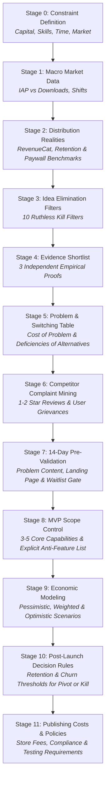

# Research & Validation Methodology

The **App Idea Validation Protocol** is an evidence-first operational framework designed to prevent founders, solo developers, and product teams from building software nobody needs, wants, or is willing to pay for.

This methodology prioritizes disciplined empirical investigation over entrepreneurial intuition, rapid prototyping hype, or cosmetic market sizing.

---

## 1. Core Philosophy

Software development has become orders of magnitude faster and cheaper due to modern frameworks, cloud primitives, and AI coding assistants. However, **market risk**—the probability that users will not adopt, retain, or pay for the product—remains unchanged or has even intensified due to market saturation.

The framework operates under five non-negotiable principles:

1. **Problem Before Product:** No user interface, tech stack, or feature set is discussed until the underlying user problem, economic consequence, and current workarounds are explicitly mapped.
2. **Evidence Before Opinion:** Every positive claim must be grounded in observable facts (published reports, verified revenue disclosures, public user reviews, direct customer interactions).
3. **Validation Before Coding:** Zero production code is written before completing a low-cost, 14-day pre-validation experiment testing message resonance and customer intent.
4. **Ruthless Stage-Gate Filtering:** Progress across stages is contingent upon passing explicit, objective decision gates. Ideas that fail gates are pivoted or eliminated without emotional attachment.
5. **Radical Transparency Regarding Risk:** No methodology guarantees commercial success. This framework aims to maximize the probability of product-market fit while driving the financial and temporal cost of failure toward zero.

---

## 2. Stage Dependencies & Lifecycle Flow

The 12-stage validation lifecycle forms an unbroken chain where each step produces concrete analytical inputs for subsequent steps:

### Stage Interdependency Details:
- **Constraints (Stage 0) feed Filters (Stage 3):** An idea requiring \$10,000 in server compute fails Stage 3 immediately if Stage 0 records a zero-capital budget.
- **Distribution Realities (Stage 2) calibrate Economics (Stage 9):** Unit economics cannot invent arbitrary 25% conversion rates when empirical industry medians sit at 2%–5%.
- **Problem & Switching Table (Stage 5) guides Complaint Mining (Stage 6):** Hypothesized switching reasons are validated or disproven by analyzing competitor negative reviews.
- **Complaint Decisions (Stage 6) dictate MVP Boundaries (Stage 8):** Recurring competitor failures directly define must-build features and deliberate anti-features.

---

## 3. Why Validate Problem Before Product?

Founders often fall victim to the "solution-first" trap: conceiving a clever software mechanism and subsequently hunting for an audience to sell it to. 

This protocol reverses that flow:
1. **Identify Existing Expenditure:** Verify that customers are already expending time, money, or emotional energy coping with an unresolved pain point.
2. **Inspect Incumbent Friction:** Analyze why existing market solutions (free built-in apps, established market leaders, or manual hacks) leave users dissatisfied.
3. **Formulate Switching Triggers:** A new product only succeeds when its perceived value outweighs the switching inertia away from current habits.

By subjecting switching hypotheses to systematic competitor review analysis (Complaint Mining) before writing code, founders avoid building features that customers do not value.

---

## 4. The Role of Heuristics vs. Empirical Evidence

Not all rules in product development carry equal weight:
- **Absolute Constraints:** Hard limits such as available cash, developer skills, or regulatory firewalls. These are deterministic.
- **Empirical Evidence:** Observed metrics such as competitor estimated revenues (Sensor Tower/Appfigures) or published benchmark reports (RevenueCat State of Subscription Apps).
- **Heuristic Thresholds:** Practical rules of thumb (e.g., 300 waitlist signups or 100K organic video views in 14 days) designed to filter out dead-end angles quickly.

Heuristics should be tailored to the specific market, language, and audience, rather than treated as immutable natural laws. See [`docs/decision-gates.md`](decision-gates.md) for detailed guidelines.
